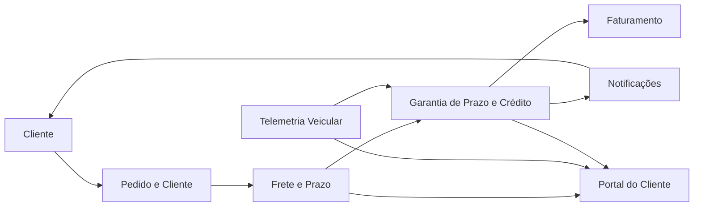

# 1. Modelagem do domínio

## Bounded contexts

Cada requisito funcional foi atribuídos a um único contexto responsável para preservar
fronteiras de negócio e evitar acoplamento entre regras de domínio.

| Contexto | Responsabilidade | Requisitos sob sua responsabilidade |
|---|---|---|
| Frete e Prazo | Define o prazo prometido pela entrega e mede o atraso em horas com base na confirmação de entrega. | RF01 |
| Garantia de Prazo e Crédito | Calcula o valor do crédito por tipo de cliente, aplica o teto, evita duplicidade e preserva extensibilidade por tipo de cliente sem alterar regras existentes. | RF02, RF03, RF04, RF09 |
| Telemetria Veicular | Coleta posição, velocidade e permanência do veículo para comprovar ausência do destinatário. | RF05 |
| Faturamento | Emite nota de crédito sequencial e nunca repetida após a concessão de um crédito. | RF06 |
| Notificações | Seleciona o canal preferido do cliente, executa o envio e faz retry até 3 tentativas com falha final explícita. | RF07, RF08 |
| Portal do Cliente | Expõe a posição do veículo, a previsão de chegada e o saldo de créditos em tempo real. | RF10 |

## Mapa de contexto

O fluxo principal é: o pedido define o cliente e o frete; o contexto de Frete e Prazo calcula o atraso; a Garantia de Prazo decide se há crédito; o Faturamento registra a nota e o cliente é informado por notificação ou pelo portal.

## Entidades e agregados

| Agregado | Raiz | Entidades e objetos de valor | Regra que protege |
|---|---|---|---|
| Pedido | Pedido | Cliente, valor do frete, tipo de cliente, código do pedido | O pedido deve ter um único cliente, um único tipo e um frete associado à entrega que será avaliada. |
| Entrega | Entrega | PrazoPrometido, DataHoraConfirmacao, AtrasoHoras, EnderecoDestino, ConfirmacaoDuplicada, AusenciaComprovada | A entrega é a fonte de verdade para o cálculo do atraso e uma mesma confirmação não pode gerar mais de um crédito. |
| Cobertura de Garantia | GarantiaDePrazo | RegraDeCredito, LimiteMaximo, TipoCliente, CreditoGerado | A aplicação da regra deve ser determinada pelo tipo do cliente e cada pedido não pode exceder o teto máximo configurado. |
| Crédito | Crédito | PedidoId, ValorCredito, Status, DataEmissao, PercentualAplicado | O crédito é emitido uma única vez para a confirmação de entrega válida e respeita o teto do tipo de cliente. |
| Nota de Crédito | NotaCredito | NumeroSequencial, PedidoId, Valor, DataEmissao, Status | Nenhuma nota pode repetir número e a geração deve ser atômica e sequencial. |
| Notificação | Notificação | ClienteId, CanalPreferido, StatusEnvio, Tentativas, Mensagem | A notificação deve seguir o canal preferido e repetir apenas até a terceira falha, com registro explícito da falha final. |
| Posicionamento do Veículo | PosicaoVeiculo | VeiculoId, Latitude, Longitude, Timestamp, PrevisaoChegada | O portal só expõe a posição e a previsão válidas quando houver telemetria atualizada e a entrega estiver em andamento. |

## Linguagem ubíqua

| Termo | Definição |
|---|---|
| Atraso | Diferença em horas entre o prazo prometido pela operação de frete e a confirmação da entrega. |
| Prazo prometido | Momento estimado de entrega informado pelo serviço de Frete para o pedido. |
| Confirmação de entrega | Registro que informa que o destinatário recebeu a entrega. |
| Crédito | Valor financeiro concedido ao cliente quando o atraso ultrapassa a tolerância e a entrega não foi anulada por ausência comprovada. |
| Tipo de cliente | Segmento do cliente: Varejo, Corporativo ou Cortesia; cada um tem regra própria de percentual e teto. |
| Ausência comprovada | Situação em que a telemetria demonstra que o veículo ficou parado a até 200 m do endereço por pelo menos 10 min antes do registro da ausência do destinatário. |
| Teto máximo | Limite financeiro máximo por pedido: R$ 500 para Varejo e R$ 2.000 para Corporativo. |
| Nota de crédito | Documento emitido no faturamento para registrar o crédito concedido ao cliente, com número sequencial e único. |
| Canal preferido | Meio de comunicação escolhido pelo cliente para receber avisos: e-mail, serviço atual ou WhatsApp. |
| Confirmação duplicada | Repetição da mesma confirmação de entrega, que deve gerar apenas um crédito. |
| Previsão de chegada | Estimativa do horário em que o veículo chegará ao destino baseada em telemetria e rota. |
| Saldo de créditos | Total de crédito acumulado para o cliente no portal, conforme regras atuais de concessão. |
