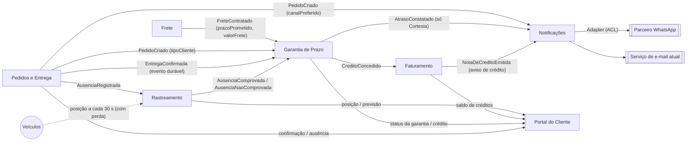

# 1. Modelagem do domínio

## Bounded contexts

| Contexto | Responsabilidade | Requisitos sob sua responsabilidade |
|---|---|---|
| **Garantia de Prazo** (novo) | Abre uma garantia para cada pedido, mede o atraso entre o Prazo Prometido e a Confirmação de Entrega, aplica a Política de Compensação do tipo de cliente e concede o crédito uma única vez | RF01, RF02, RF03, RF04, RF09, RNF02 |
| **Rastreamento** (telemetria da frota) | Recebe as posições dos veículos e avalia cada Registro de Ausência: comprovado se o veículo ficou parado a até 200 m do endereço por pelo menos 10 min antes do registro | RF05, RNF01a |
| **Pedidos e Entrega** (Pedidos, Java) | Mantém o pedido com o cliente, o Tipo de Cliente e o Canal Preferido; registra a Confirmação de Entrega e o Registro de Ausência feitos pelo entregador e os publica sem perda | RNF01b |
| **Frete** (Python) | Calcula o valor do frete e define o Prazo Prometido no momento da contratação | Fonte de dados de RF01 e RF02 (não é dono de RF novo) |
| **Faturamento** (C#) | Emite a Nota de Crédito com número sequencial e único, e mantém o saldo de créditos do cliente | RF06, RNF03 |
| **Notificações** (Node/TS) | Envia o aviso pelo Canal Preferido do cliente (e-mail ou WhatsApp), faz até 3 retentativas e encaminha a falha final para tratamento | RF07, RF08 |
| **Portal do Cliente** (React + BFF) | Mostra ao cliente a posição do veículo, a previsão de chegada e o saldo de créditos, com atualização ao vivo | RF10 |

> **Decisão sobre o RF05:** o RF05 fica no Rastreamento, não na Garantia. Distância, tempo
> parado e posição GPS são linguagem da telemetria. A Garantia só recebe o veredito
> (`AusenciaComprovada` ou `AusenciaNaoComprovada`) e reage a ele, sem conhecer coordenadas.
>
> **Decisão sobre o RNF01:** o requisito tem duas metades com donos diferentes, por isso foi
> dividido. **RNF01a** (a telemetria chega a cada 30 s e tolera perda) é do Rastreamento, que
> trata as posições como fluxo contínuo em que um pacote perdido é substituído pelo seguinte.
> **RNF01b** (a confirmação de entrega não tolera perda) é de Pedidos e Entrega, que é quem
> produz a confirmação e precisa publicá-la de forma durável.
>
> **Decisão sobre o RNF02:** a Garantia é dona do prazo de 5 min, porque é ela que dispara a
> emissão do crédito. O Faturamento consome o `CreditoConcedido` de forma assíncrona; o tempo
> dele entra no orçamento dos 5 min e é tratado na arquitetura.
>
> **RNF04** (contêineres e subida com um comando) é transversal e fica na infraestrutura
> (`docker-compose.yml`), não em um contexto de negócio.

## Mapa de contexto

| Relação | Tipo | Observação |
|---|---|---|
| Frete → Garantia | Upstream / Downstream (Conformist) | A Garantia aceita o Prazo Prometido e o Valor do Frete como o Frete os define, recebidos no `FreteContratado` |
| Pedidos e Entrega → Garantia | Upstream / Downstream (Published Language) | O `PedidoCriado` informa o Tipo de Cliente; a `EntregaConfirmada` é um evento publicado com contrato estável |
| Pedidos e Entrega → Notificações | Upstream / Downstream | O `PedidoCriado` informa o Canal Preferido do cliente para aquele pedido |
| Rastreamento → Garantia | Upstream / Downstream | O Rastreamento entrega só o veredito da ausência, sem os dados brutos |
| Garantia → Faturamento | Customer / Supplier | O Faturamento emite a nota a partir do crédito concedido |
| Faturamento → Notificações | Upstream / Downstream | A `NotaDeCreditoEmitida` é o **único** gatilho do aviso de crédito, para o cliente não receber dois avisos; o aviso só sai quando a nota já existe |
| Garantia → Notificações | Upstream / Downstream | O `AtrasoConstatado` é usado só para o Cliente Cortesia, que é avisado do atraso sem receber crédito (RF03) |
| Notificações → Parceiro WhatsApp | Anticorruption Layer | A API do parceiro tem formato diferente e é traduzida por um Adapter |
| Portal ← Rastreamento / Faturamento / Garantia / Pedidos e Entrega | Read model (BFF) | O Portal só lê, sem regra de negócio |

### Origem dos dados que a Garantia e as Notificações usam

| Dado | Contexto dono | Como chega |
|---|---|---|
| Prazo Prometido | Frete | Evento `FreteContratado { pedidoId, prazoPrometido, valorFrete }` |
| Valor do Frete | Frete | Mesmo evento `FreteContratado` |
| Tipo de Cliente | Pedidos e Entrega | Evento `PedidoCriado { pedidoId, clienteId, tipoCliente, canalPreferido }`; o tipo vigente na criação do pedido vale para a garantia daquele pedido |
| Canal Preferido | Pedidos e Entrega | Mesmo evento `PedidoCriado`, consumido pelas Notificações |
| Confirmação de Entrega | Pedidos e Entrega | Evento `EntregaConfirmada { entregaId, pedidoId, confirmadaEm, registrosDeAusencia[] }` |
| Veredito da ausência | Rastreamento | Eventos `AusenciaComprovada` e `AusenciaNaoComprovada { pedidoId, registroAusenciaId }` |

### Ordem entre ausência e confirmação (RF05)

O Registro de Ausência acontece numa tentativa de entrega que falhou, então ele sempre
**precede** a Confirmação de Entrega de uma nova tentativa. A `EntregaConfirmada` lista os
registros de ausência anteriores do pedido. Se algum deles ainda não tiver veredito do
Rastreamento, a Garantia **aguarda o veredito** antes de calcular o crédito: com
`AusenciaComprovada`, passa a `Isenta`; com `AusenciaNaoComprovada`, segue o cálculo normal.
Assim, uma confirmação que chega antes do veredito nunca gera um crédito indevido.

## Entidades e agregados

| Agregado | Raiz | Entidades e objetos de valor | Regra que protege |
|---|---|---|---|
| **Garantia** (Garantia de Prazo) | `Garantia` (uma por pedido) | VO `PedidoId`, VO `PrazoPrometido`, VO `TipoCliente`, VO `ValorFrete` (Dinheiro), VO `Atraso` (minutos), VO `Credito`; entidade `ConfirmacaoEntrega`; status `Ativa → Cumprida \| Violada \| Isenta` | Uma garantia concede **no máximo um** crédito (RF09); o crédito nunca passa do teto do tipo de cliente (RF02/RF03); com atraso, a garantia passa a `Violada`, e no Cliente Cortesia ela fica `Violada` com crédito de R$ 0,00 e publica `AtrasoConstatado` (RF03); ao receber `AusenciaComprovada`, a garantia passa a `Isenta` e não gera crédito (consequência do RF05, avaliado no Rastreamento); enquanto houver registro de ausência sem veredito, o crédito não é calculado |
| **AvaliacaoAusencia** (Rastreamento) | `AvaliacaoAusencia` | VO `Posicao` (lat/long), VO `Geocerca` (endereço + raio de 200 m), VO `JanelaParada` (≥ 10 min antes do registro) | Ausência só é comprovada se as posições mostrarem o veículo parado dentro da geocerca durante a janela inteira (RF05); todo registro recebe um veredito, comprovado ou não |
| **NotaDeCredito** (Faturamento) | `NotaDeCredito` | VO `NumeroNota` (sequencial), VO `Valor`, VO `CreditoId` (origem) | Número sequencial e nunca repetido, inclusive sob concorrência (RF06/RNF03); uma nota por `CreditoId` |
| **Notificacao** (Notificações) | `Notificacao` | VO `CanalPreferido` (EMAIL \| WHATSAPP), entidade `TentativaEnvio`, status `Pendente → Enviada \| FalhaDefinitiva` | No máximo 1 envio + 3 retentativas; a falha definitiva sempre é registrada e encaminhada, nunca descartada (RF08) |

> **Serviço de domínio `PoliticaCompensacao`** (Garantia de Prazo): não é um agregado, porque
> não tem estado que mude nem ciclo de vida. É uma regra fixa, uma por tipo de cliente,
> formada pelos VOs `FaixaAtraso` (limite em minutos → percentual), `Multiplicador` e `Teto`.
> O agregado `Garantia` a usa para calcular o crédito. Um tipo de cliente novo é uma política
> nova, sem alterar as existentes (RF04). Na arquitetura, é onde se aplica o padrão Strategy.

## Linguagem ubíqua

| Termo | Definição |
|---|---|
| **Garantia de Prazo** | Compromisso de compensar o cliente com crédito quando a entrega de um pedido atrasar |
| **Prazo Prometido** | Data e hora limite de entrega definidas pelo serviço de Frete na contratação |
| **Valor do Frete** | Valor cobrado pelo frete do pedido, definido pelo Frete. É a base de cálculo do crédito |
| **Confirmação de Entrega** | Registro, feito pelo entregador, de que o pedido foi entregue, com data e hora. Fonte oficial do fim da entrega |
| **Atraso** | Diferença entre a Confirmação de Entrega e o Prazo Prometido, contada em **minutos e arredondada para cima** (qualquer fração de minuto conta como minuto inteiro) e exibida em horas. Assim, 2h00m00s = 120 min (sem crédito) e 2h00m01s = 121 min ("acima de 2 h"). Atraso ≤ 0 significa entrega no prazo (RF01) |
| **Faixa de Atraso** | Intervalo de atraso associado a um percentual do frete: até 2 h → 0%; acima de 2 h até 24 h → 10%; acima de 24 h até 72 h → 25%; acima de 72 h → 50% (RF02) |
| **Tipo de Cliente** | Classificação comercial que define a Política de Compensação: Varejo, Corporativo ou Cortesia. Informada por Pedidos e Entrega na criação do pedido |
| **Política de Compensação** | Regra que transforma atraso e frete em valor de crédito para um Tipo de Cliente |
| **Multiplicador** | Fator aplicado aos percentuais da faixa: 1× para Varejo, 2× para Corporativo (RF03) |
| **Teto** | Valor máximo de crédito por pedido: R$ 500 (Varejo) e R$ 2.000 (Corporativo) |
| **Crédito** | Valor concedido ao cliente pelo atraso, já limitado pelo teto. Gerado no máximo uma vez por pedido |
| **Cliente Cortesia** | Tipo de cliente cujo frete é zero. Com atraso, a garantia fica `Violada` sem crédito, e o cliente é notificado do atraso (RF03) |
| **Registro de Ausência** | Apontamento do entregador, numa tentativa que falhou, de que o destinatário não estava no endereço |
| **Ausência Comprovada** | Registro de Ausência confirmado pela telemetria: veículo parado a até 200 m do endereço por pelo menos 10 min antes do registro. Isenta a garantia (RF05) |
| **Ausência Não Comprovada** | Registro de Ausência que a telemetria não confirmou. A garantia segue o cálculo normal |
| **Garantia Isenta** | Garantia encerrada sem crédito por causa de uma Ausência Comprovada |
| **Nota de Crédito** | Documento fiscal emitido pelo Faturamento para cada crédito, com Número de Nota sequencial e único (RF06). Sua emissão é o gatilho do aviso de crédito ao cliente |
| **Saldo de Créditos** | Soma dos créditos disponíveis do cliente, exibida no Portal (RF10) |
| **Canal Preferido** | Meio escolhido pelo cliente para receber avisos: e-mail ou WhatsApp (RF07). Informado por Pedidos e Entrega |
| **Falha Definitiva** | Notificação que falhou no envio original e nas 3 retentativas. Vai para a fila de falhas e gera alerta (RF08); o mecanismo da fila é detalhado na arquitetura |
