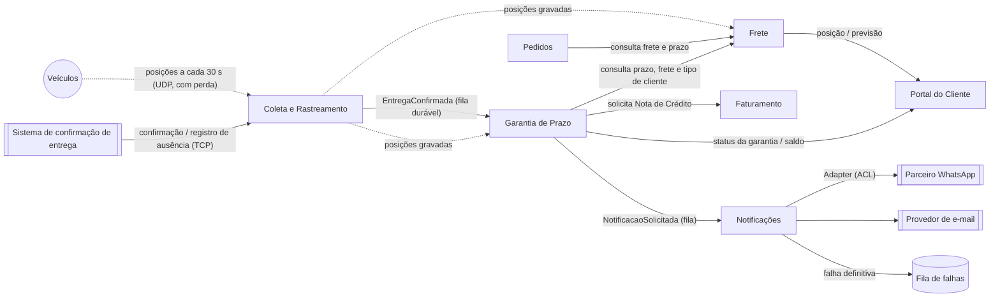

# 1. Modelagem do domínio

A modelagem segue os serviços e as comunicações definidos em
[`02-arquitetura.md`](02-arquitetura.md): cada contexto abaixo corresponde a um serviço do
`compose`, e cada seta do mapa corresponde a uma linha da tabela de protocolos.

## Bounded contexts

| Contexto | Responsabilidade | Requisitos sob sua responsabilidade |
|---|---|---|
| **Garantia de Prazo** (novo, `garantia-prazo`) | Consome a Confirmação de Entrega da fila durável, consulta o Frete, valida a ausência do destinatário, mede o atraso, aplica a Política de Compensação, solicita a Nota de Crédito ao Faturamento, mantém o Saldo de Créditos e solicita as notificações | RF01, RF02, RF03, RF04, RF05, RF09, RNF02 |
| **Coleta e Rastreamento** (novo, `coletor`) | Recebe as posições dos veículos por UDP e as grava; recebe as Confirmações de Entrega e os Registros de Ausência por TCP e os publica na fila durável | RNF01 |
| **Frete** (Python, `frete`) | Calcula o Valor do Frete conforme o Tipo de Cliente, define o Prazo Prometido e calcula a previsão de chegada; responde à Garantia e ao Painel | Fonte de dados de RF01, RF02 e RF10 (não é dono de RF novo) |
| **Faturamento** (C#, `faturamento`) | Emite a Nota de Crédito, a pedido da Garantia, com número sequencial e único | RF06, RNF03 |
| **Notificações** (Node/TS, `notificacoes`) | Guarda o Canal Preferido do cliente, envia os avisos por e-mail ou WhatsApp, faz até 3 retentativas e encaminha a falha final para a fila de falhas | RF07, RF08 |
| **Portal do Cliente** (React, `painel`) | Mostra ao cliente a posição do veículo, a previsão de chegada e o saldo de créditos, com atualização ao vivo | RF10 |
| **Pedidos** (Java, `pedidos`) | Mantém os pedidos e consulta o Frete na contratação | Nenhum requisito novo |

> **Decisão sobre o RF05:** a ausência comprovada é uma **exceção da garantia**, então a regra
> fica na Garantia de Prazo, isolada no serviço de domínio `ValidacaoAusencia` (Strategy na
> arquitetura) para não se misturar ao cálculo do crédito. A Garantia não coleta posições: ela
> lê as posições que o Coletor já gravou.
>
> **Decisão sobre o RNF01:** as duas metades do requisito entram pelo mesmo contexto, o Coletor,
> que tem um canal para cada uma: **UDP** para a telemetria, que tolera perda, e **TCP + fila
> durável** para a confirmação, que não tolera perda. Por isso o RNF01 tem um único dono.
>
> **Decisão sobre o RNF02:** a Garantia é dona do prazo de 5 min, porque conduz o fluxo inteiro:
> consome a confirmação, chama o Frete e o Faturamento e publica a notificação.
>
> **RNF04** (contêineres e subida com um comando) é transversal e fica na infraestrutura
> (`compose.yaml`), não em um contexto de negócio.

## Mapa de contexto

| Relação | Tipo | Observação |
|---|---|---|
| Coleta e Rastreamento → Garantia | Upstream / Downstream (Published Language) | A `EntregaConfirmada` é publicada na fila durável com contrato estável; as posições são lidas do armazenamento do Coletor |
| Frete → Garantia | Upstream / Downstream (Conformist) | A Garantia aceita o Prazo Prometido, o Valor do Frete e o Tipo de Cliente como o Frete os informa |
| Garantia → Faturamento | Customer / Supplier | A Garantia solicita a nota e recebe o número na resposta |
| Garantia → Notificações | Upstream / Downstream | A `NotificacaoSolicitada` é o **único** gatilho de aviso ao cliente sobre a Garantia de Prazo: crédito (com o número da nota) ou atraso do Cliente Cortesia |
| Notificações → Parceiro WhatsApp | Anticorruption Layer | A API do parceiro tem formato diferente e é traduzida por um Adapter |
| Portal ← Frete / Garantia | Read model | O Portal só lê, sem regra de negócio |

### Origem dos dados que a Garantia e as Notificações usam

| Dado | Contexto dono | Como chega |
|---|---|---|
| Prazo Prometido | Frete | Resposta da consulta da Garantia ao Frete: `{ pedidoId, prazoPrometido, valorFrete, tipoCliente }` |
| Valor do Frete | Frete | Mesma resposta |
| Tipo de Cliente | Frete | Mesma resposta. O Frete conhece o tipo porque precifica por ele (o Cliente Cortesia tem frete zero) |
| Confirmação de Entrega e Registro de Ausência | Coleta e Rastreamento | Mensagens `EntregaConfirmada { entregaId, pedidoId, confirmadaEm }` e `AusenciaRegistrada { pedidoId, registradaEm, endereco }` na fila durável |
| Posições do veículo | Coleta e Rastreamento | Gravadas pelo Coletor e lidas pela Garantia (RF05) e pelo Frete (previsão e Portal) |
| Número da Nota de Crédito | Faturamento | Resposta da solicitação de nota feita pela Garantia |
| Canal Preferido | Notificações | Guardado no próprio serviço de Notificações |

### Ordem entre ausência e confirmação (RF05)

O Registro de Ausência acontece numa tentativa de entrega que falhou, então ele sempre
**precede** a Confirmação de Entrega de uma nova tentativa. As duas mensagens entram pelo mesmo
canal TCP do Coletor e pela mesma fila durável, na ordem em que foram registradas. Quando a
Garantia processa a confirmação, os registros de ausência do pedido já estão gravados, e a
`ValidacaoAusencia` é executada antes do cálculo do crédito.

## Entidades e agregados

| Agregado | Raiz | Entidades e objetos de valor | Regra que protege |
|---|---|---|---|
| **Garantia** (Garantia de Prazo) | `Garantia` (uma por pedido) | VO `PedidoId`, VO `PrazoPrometido`, VO `TipoCliente`, VO `ValorFrete` (Dinheiro), VO `Atraso` (minutos), VO `Credito`, VO `NumeroNota`; entidades `ConfirmacaoEntrega` e `RegistroAusencia`; status `Ativa → Cumprida \| Violada \| Isenta` | Uma confirmação de entrega gera **no máximo um** crédito (RF09); o crédito nunca passa do teto do tipo de cliente (RF02/RF03); com atraso, a garantia passa a `Violada`, e no Cliente Cortesia ela fica `Violada` com crédito de R$ 0,00 e solicita só o aviso de atraso (RF03); se a `ValidacaoAusencia` comprovar a ausência, a garantia passa a `Isenta` e não gera crédito (RF05) |
| **SaldoCreditos** (Garantia de Prazo) | `SaldoCreditos` (um por cliente) | VO `ClienteId`, VO `Dinheiro`; lista de créditos lançados | Cada crédito entra no saldo uma única vez; o saldo é a soma dos créditos lançados (RF10) |
| **NotaDeCredito** (Faturamento) | `NotaDeCredito` | VO `NumeroNota` (sequencial), VO `Valor`, VO `CreditoId` (origem) | Número sequencial e nunca repetido, inclusive sob concorrência (RF06/RNF03); uma nota por `CreditoId`, mesmo se a Garantia repetir a solicitação |
| **Notificacao** (Notificações) | `Notificacao` | VO `CanalPreferido` (EMAIL \| WHATSAPP), entidade `TentativaEnvio`, status `Pendente → Enviada \| FalhaDefinitiva` | No máximo 1 envio + 3 retentativas; a falha definitiva sempre é registrada e encaminhada, nunca descartada (RF08) |

> **Serviços de domínio da Garantia de Prazo** (sem estado nem ciclo de vida, por isso não são
> agregados):
>
> - **`PoliticaCompensacao`**: uma regra fixa por tipo de cliente, formada pelos VOs
>   `FaixaAtraso` (limite em minutos → percentual), `Multiplicador` e `Teto`. Na arquitetura, é
>   o **Strategy** do cálculo, escolhido pelo tipo de cliente (**Factory**). Um tipo de cliente
>   novo é uma política nova, sem alterar as existentes (RF04).
> - **`ValidacaoAusencia`**: verifica, com os VOs `Posicao` (lat/long), `Geocerca` (endereço +
>   raio de 200 m) e `JanelaParada` (≥ 10 min antes do registro), se o veículo ficou parado
>   dentro da geocerca durante a janela inteira (RF05). Na arquitetura, é o **Strategy** da
>   validação de ausência.

## Linguagem ubíqua

| Termo | Definição |
|---|---|
| **Garantia de Prazo** | Compromisso de compensar o cliente com crédito quando a entrega de um pedido atrasar |
| **Prazo Prometido** | Data e hora limite de entrega definidas pelo serviço de Frete na contratação |
| **Valor do Frete** | Valor cobrado pelo frete do pedido, definido pelo Frete. É a base de cálculo do crédito |
| **Confirmação de Entrega** | Registro, feito pelo entregador, de que o pedido foi entregue, com data e hora. Chega pelo Coletor e é a fonte oficial do fim da entrega |
| **Atraso** | Diferença entre a Confirmação de Entrega e o Prazo Prometido, contada em **minutos e arredondada para cima** (qualquer fração de minuto conta como minuto inteiro) e exibida em horas. Assim, 2h00m00s = 120 min (sem crédito) e 2h00m01s = 121 min ("acima de 2 h"). Atraso ≤ 0 significa entrega no prazo (RF01) |
| **Faixa de Atraso** | Intervalo de atraso associado a um percentual do frete: até 2 h → 0%; acima de 2 h até 24 h → 10%; acima de 24 h até 72 h → 25%; acima de 72 h → 50% (RF02) |
| **Tipo de Cliente** | Classificação comercial que define a Política de Compensação: Varejo, Corporativo ou Cortesia. Informada pelo Frete |
| **Política de Compensação** | Regra que transforma atraso e frete em valor de crédito para um Tipo de Cliente |
| **Multiplicador** | Fator aplicado aos percentuais da faixa: 1× para Varejo, 2× para Corporativo (RF03) |
| **Teto** | Valor máximo de crédito por pedido: R$ 500 (Varejo) e R$ 2.000 (Corporativo) |
| **Crédito** | Valor concedido ao cliente pelo atraso, já limitado pelo teto. Gerado no máximo uma vez por confirmação de entrega |
| **Cliente Cortesia** | Tipo de cliente cujo frete é zero. Com atraso, a garantia fica `Violada` sem crédito, e o cliente é notificado do atraso (RF03) |
| **Registro de Ausência** | Apontamento do entregador, numa tentativa que falhou, de que o destinatário não estava no endereço |
| **Ausência Comprovada** | Registro de Ausência confirmado pelas posições do veículo: parado a até 200 m do endereço por pelo menos 10 min antes do registro. Isenta a garantia (RF05) |
| **Garantia Isenta** | Garantia encerrada sem crédito por causa de uma Ausência Comprovada |
| **Nota de Crédito** | Documento fiscal emitido pelo Faturamento para cada crédito, com Número de Nota sequencial e único (RF06) |
| **Saldo de Créditos** | Soma dos créditos do cliente, mantida pela Garantia de Prazo e exibida no Portal (RF10) |
| **Solicitação de Notificação** | Mensagem que a Garantia publica na fila para avisar o cliente: crédito concedido (com o número da nota) ou atraso do Cliente Cortesia |
| **Canal Preferido** | Meio escolhido pelo cliente para receber avisos: e-mail ou WhatsApp (RF07). Guardado pelas Notificações |
| **Falha Definitiva** | Notificação que falhou no envio original e nas 3 retentativas. Vai para a fila de falhas (DLQ) e gera alerta (RF08) |
