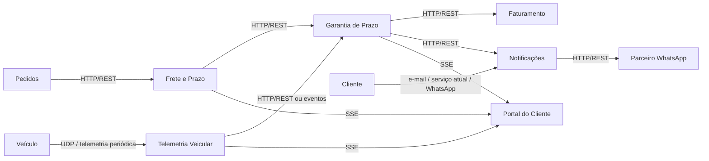

# 2. Arquitetura

## Diagrama dos serviços

A arquitetura usa microserviços com integração assíncrona para o fluxo de crédito e sincronização para o portal e telemetria.



## Protocolo de cada comunicação

| Origem | Destino | Protocolo | Requisito atendido | Justificativa |
|---|---|---|---|---|
| Veículo | Telemetria Veicular | UDP | RNF01 | A telemetria é periódica e tolera perda de pacotes; UDP é adequado para streaming leve e tolerante a perdas. |
| Telemetria Veicular | Garantia de Prazo | HTTP/REST ou eventos assíncronos | RF05, RNF02 | O serviço de garantia precisa consumir a posição e a permanência do veículo para decidir ausência comprovada, sem bloquear a entrega. |
| Serviço de Frete | Garantia de Prazo | HTTP/REST | RF01, RF02, RF03 | A confirmação de entrega e o prazo prometido devem ser entregues com consistência e sem perda; REST com resposta explícita é apropriado. |
| Garantia de Prazo | Faturamento | HTTP/REST ou filas assíncronas | RF06, RNF02, RNF03 | O crédito precisa ser registrado em até 5 minutos, e a emissão de nota deve ocorrer em uma transação consistente, com sequenciamento único. |
| Garantia de Prazo | Notificações | HTTP/REST ou fila de eventos | RF07, RF08 | O envio de notificação deve ser retriado até 3 vezes e o erro final precisa ser registrado, sem descarte silencioso. |
| Notificações | Parceiro WhatsApp | HTTP/REST | RF07 | A API do parceiro tem formato diferente do serviço atual, então a adaptação fica no adaptador do cliente externo. |
| Portal do Cliente | Cliente | SSE | RF10 | Atualização ao vivo sem polling pesado; o cliente recebe posição, previsão e saldo de crédito em tempo real. |
| Pedido / Frete / Garantia | Portal | SSE | RF10 | O portal precisa refletir mudanças em tempo real, sem exigência de recarga manual dos usuários. |

## Padrões de projeto

| Ponto da solução | Padrão | Requisito | Justificativa |
|---|---|---|---|
| Cálculo do crédito por tipo de cliente | Strategy | RF02, RF03, RF04 | Cada tipo de cliente (Varejo, Corporativo, Cortesia) implementa sua própria política. Isso permite adicionar um novo tipo sem mudar a lógica existente. |
| Adaptação da API do parceiro de mensagens | Adapter | RF07 | A API externa do WhatsApp tem formato diferente do canal atual; o adaptador converte o payload interno para o formato do parceiro. |
| Retentativa de entrega de notificação | Retry + dead-letter / log explícito | RF08 | O serviço de notificações tenta até 3 vezes e, se falhar, registra a falha final de modo visível para operação e auditoria. |
| Evitar crédito duplicado | Idempotency Key / deduplicação por chave estável | RF09 | A mesma confirmação de entrega chega duas vezes; a garantia usa um identificador único de confirmação para impedir a segunda emissão. |
| Emissão de nota sequencial | Sequence / database transaction | RF06, RNF03 | O número da nota é gerado no mesmo bloco transacional que salva a nota, garantindo unicidade mesmo com concorrência. |
| Atualização ao vivo do portal | Publisher/Subscriber + SSE | RF10 | O portal assina eventos de atualização para visualizar veículo, previsão e saldo de crédito em tempo real. |

### Ponto onde a dupla decidiu não aplicar padrão

A solução decidiu não aplicar o padrão Chain of Responsibility para as regras de crédito. Embora pareça natural encadear regras como “Varejo → Corporativo → Cortesia”, a regra de negócio é melhor modelada como uma tabela de políticas por tipo de cliente, usando Strategy, porque cada tipo tem uma definição explícita de percentual e teto. Isso reduz acoplamento e facilita a extensão com um novo cliente sem mexer nas regras já existentes.

## Confirmação de entrega duplicada (RF09)

A garantia de idempotência fica no serviço de Garantia de Prazo. Sempre que chega uma confirmação de entrega, o sistema calcula uma chave de deduplicação baseada no pedido e no identificador da entrega ou evento de confirmação. A chave é persistida junto com o resultado do processamento em um armazenamento de eventos/estado.

Fluxo:
1. O serviço recebe a confirmação.
2. Consulta se essa chave já foi processada.
3. Se não foi, calcula o crédito e persiste a chave + o crédito gerado.
4. Se já foi processada, retorna o resultado anterior e não gera um segundo crédito.

Esse mecanismo garante que a mesma confirmação de entrega, mesmo repetida em latência ou retriada, produza apenas um crédito.

## Numeração das notas de crédito (RF06 e RNF03)

A numeração fica no domínio de Faturamento, em um banco relacional com sequência transacional. A nota de crédito é criada dentro da mesma transação que registra o crédito, e o número é gerado por uma sequence/identity do banco, em vez de ser gerado no código de aplicação.

Vantagens:
- unicidade sob 1.000 emissões concorrentes;
- ordem cronológica preservada;
- ausência de colisão entre threads, pods ou instâncias;
- sem necessidade de coordenação manual entre serviços.

O número da nota é então usado como identificador exclusivo do documento de crédito, com jamais repetição.

## Execução em contêineres (RNF04)

A solução foi pensada para subir com um único comando, usando Docker Compose. O arquivo abaixo ilustra os serviços principais e suas dependências.

```yaml
version: "3.9"

services:
  db:
    image: postgres:16
    environment:
      POSTGRES_DB: logitech
      POSTGRES_USER: app
      POSTGRES_PASSWORD: app
    ports:
      - "5432:5432"

  redis:
    image: redis:7
    ports:
      - "6379:6379"

  telemetry:
    build: ./telemetria
    ports:
      - "8081:8081"
    depends_on:
      - db

  garantia:
    build: ./garantia
    ports:
      - "8082:8082"
    depends_on:
      - db
      - redis

  faturamento:
    build: ./faturamento
    ports:
      - "8083:8083"
    depends_on:
      - db

  notificacoes:
    build: ./notificacoes
    ports:
      - "8084:8084"
    depends_on:
      - redis

  portal:
    build: ./portal
    ports:
      - "3000:3000"
    depends_on:
      - garantia
      - telemetry

  gateway:
    image: nginx:alpine
    ports:
      - "80:80"
    depends_on:
      - portal
      - garantia
      - faturamento
      - notificacoes
```

Comando esperado para subir o conjunto:

```bash
docker compose up --build
```

Essa abordagem atende ao RNF04 porque o ambiente completo é orquestrado por um único ponto de entrada e mantém a execução dos serviços isolada em contêineres.
