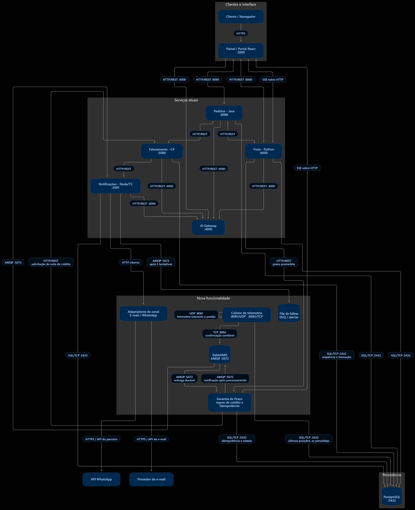

# 2. Arquitetura

## Diagrama dos serviços

<!-- Desenhe os serviços e cada comunicação entre eles. Toda seta indica o protocolo
usado (TCP, UDP, HTTP, SSE, ...). -->




## Protocolo de cada comunicação

| Origem                            | Destino                       | Protocolo            | Requisito atendido                     | Justificativa                                                                                                                  |
| --------------------------------- | ----------------------------- | -------------------- | -------------------------------------- | ------------------------------------------------------------------------------------------------------------------------------ |
| Pedidos (:8080)                   | Faturamento (:5080)           | HTTP/REST sobre TCP  | Integração entre pedidos e faturamento | Permite comunicação síncrona entre os serviços.                                                                                |
| Pedidos (:8080)                   | Frete (:8000)                 | HTTP/REST sobre TCP  | RF01, RF10                             | Consulta informações de frete e prazo prometido.                                                                               |
| Faturamento (:5080)               | Notificações (:3001)          | HTTP/REST sobre TCP  | RF07                                   | Integração com o serviço de notificações existente.                                                                            |
| Coletor (:8081/UDP)               | Sistema de telemetria         | UDP                  | RF05, RNF01                            | Recebe posições frequentes dos veículos, tolerando perda de pacotes.                                                           |
| Sistema de confirmação de entrega | Coletor (:8082/TCP)           | TCP                  | RF01, RF09, RNF01                      | Transporta confirmações de entrega com confiabilidade no transporte; a persistência durável deve ser garantida pela aplicação. |
| Coletor (:8082/TCP)               | Fila durável (RabbitMQ :5672) | AMQP sobre TCP       | RNF01, RNF02                           | Permite processamento assíncrono e preservação de confirmações após publicação durável.                                        |
| Fila durável (RabbitMQ :5672)     | Garantia de Prazo             | AMQP sobre TCP       | RF01, RF05, RF09, RNF02                | Encaminha confirmações para cálculo do atraso, validação de exceções e processamento idempotente.                              |
| Frete (:8000)                     | Garantia de Prazo             | HTTP/REST sobre TCP  | RF01                                   | Fornece o prazo prometido e os dados necessários ao cálculo do atraso.                                                         |
| Garantia de Prazo                 | Faturamento (:5080)           | HTTP/REST sobre TCP  | RF02, RF03, RF06, RF09, RNF02, RNF03   | Solicita a emissão de notas de crédito, com idempotência e numeração sequencial única.                                         |
| Garantia de Prazo                 | PostgreSQL (:5432)            | PostgreSQL sobre TCP | RF09, RNF02                            | Persiste o estado do processamento e impede créditos duplicados por meio de restrições únicas e transações.                    |
| Faturamento (:5080)               | PostgreSQL (:5432)            | PostgreSQL sobre TCP | RF06, RNF03                            | Persiste notas de crédito e gera números sequenciais sem repetição em emissões concorrentes.                                   |
| Pedidos (:8080)                   | PostgreSQL (:5432)            | PostgreSQL sobre TCP | Persistência dos pedidos               | Permite armazenar e consultar dados dos pedidos.                                                                               |
| Frete (:8000)                     | PostgreSQL (:5432)            | PostgreSQL sobre TCP | RF01, RF10                             | Persiste dados de frete, prazos e informações necessárias à previsão de entrega.                                               |
| Notificações (:3001)              | PostgreSQL (:5432)            | PostgreSQL sobre TCP | RF07, RF08                             | Registra preferências, tentativas e resultados dos envios, permitindo rastrear falhas.                                         |
| Coletor                           | PostgreSQL (:5432)            | PostgreSQL sobre TCP | RF05, RF10                             | Permite consultar e persistir posições e eventos de telemetria para verificar ausência e exibir localização.                   |
| Garantia de Prazo                 | Fila durável (RabbitMQ :5672) | AMQP sobre TCP       | RF07, RF08                             | Publica solicitações de notificação de forma assíncrona, desacoplando o cálculo do crédito do envio.                           |
| Fila durável (RabbitMQ :5672)     | Notificações (:3001)          | AMQP sobre TCP       | RF07, RF08                             | Encaminha notificações para processamento e retentativas sem bloquear a emissão do crédito.                                    |
| Notificações (:3001)              | API parceira de WhatsApp      | HTTPS sobre TCP      | RF07                                   | Envia mensagens pelo canal preferido usando um adaptador para o formato específico da API externa.                             |
| Notificações (:3001)              | Provedor de e-mail            | HTTPS sobre TCP      | RF07                                   | Envia e-mails pelo serviço existente.                                                                                          |
| Notificações (:3001)              | Fila de falhas (DLQ)          | AMQP sobre TCP       | RF08                                   | Registra notificações que falharam após as três tentativas, evitando descarte silencioso.                                      |
| Painel (:3000)                    | Frete (:8000)                 | HTTP/REST sobre TCP  | RF10                                   | Consulta posição do veículo e previsão de chegada.                                                                             |
| Painel (:3000)                    | Garantia de Prazo             | HTTP/REST sobre TCP  | RF10                                   | Consulta o saldo de créditos do cliente.                                                                                       |
| Frete (:8000)                     | Painel (:3000)                | SSE sobre HTTP/TCP   | RF10                                   | Transmite atualizações ao vivo de posição e previsão de chegada, caso o serviço exponha um endpoint SSE.                       |
| Garantia de Prazo                 | Painel (:3000)                | SSE sobre HTTP/TCP   | RF10                                   | Transmite atualizações ao vivo do saldo de créditos, caso o serviço exponha um endpoint SSE.                                   |
| Pedidos (:8080)                   | AI Gateway (:4000)            | HTTP/REST sobre TCP  | Integração de IA                       | Centraliza o acesso às ferramentas de IA.                                                                                      |
| Frete (:8000)                     | AI Gateway (:4000)            | HTTP/REST sobre TCP  | Integração de IA                       | Centraliza o acesso às ferramentas de IA.                                                                                      |
| Faturamento (:5080)               | AI Gateway (:4000)            | HTTP/REST sobre TCP  | Integração de IA                       | Centraliza o acesso às ferramentas de IA.                                                                                      |
| Notificações (:3001)              | AI Gateway (:4000)            | HTTP/REST sobre TCP  | Integração de IA                       | Centraliza o acesso às ferramentas de IA.                                                                                      |
| Painel (:3000)                    | AI Gateway (:4000)            | HTTP/REST sobre TCP  | Integração de IA                       | Centraliza o acesso às ferramentas de IA.                                                                                      |

## Padrões de projeto

<!-- Para cada ponto da solução onde um padrão se aplica: qual padrão, qual problema
ele resolve e qual requisito motiva a escolha. -->

| Ponto da solução                                                                                | Padrão         | Requisito                | Justificativa                                                                                                                                                                                          |
| ----------------------------------------------------------------------------------------------- | -------------- | ------------------------ | ------------------------------------------------------------------------------------------------------------------------------------------------------------------------------------------------------ |
| Cálculo do crédito conforme o tipo de cliente (Varejo, Corporativo e Cortesia)                  | Strategy       | RF02, RF03, RF04         | Encapsula as regras de cálculo em estratégias independentes, permitindo adicionar novos tipos de cliente sem alterar as regras existentes.                                                             |
| Seleção da estratégia de cálculo conforme o tipo de cliente                                     | Factory Method | RF02, RF03, RF04         | Centraliza a criação da estratégia adequada para cada tipo de cliente, evitando condicionais espalhadas pelo código e facilitando a inclusão de novas políticas.                                       |
| Persistência de pedidos, notas de crédito, confirmações de entrega e estado do processamento    | Repository     | RF06, RF09, RNF02, RNF03 | Isola o acesso ao PostgreSQL da lógica de negócio e permite consultar e persistir dados com transações e restrições de unicidade para evitar créditos duplicados.                                      |
| Geração de números sequenciais para notas de crédito                                            | Repository     | RF06, RNF03              | Centraliza a persistência e o acesso à numeração das notas, utilizando sequências ou operações atômicas no banco para evitar repetições em emissões concorrentes.                                      |
| Acesso compartilhado a um componente que gerencia configurações ou recursos internos do serviço | Singleton      | RNF02, RNF03             | Garante uma única instância do componente dentro de cada processo, evitando instâncias redundantes. A unicidade global dos números de nota deve ser garantida pelo banco de dados, não pelo Singleton. |
| Integração com a API externa de WhatsApp                                                        | Adapter        | RF07                     | Converte a interface interna de notificações para o formato específico da API do parceiro, permitindo integrar canais com contratos diferentes sem alterar a lógica de negócio.                        |
| Envio de notificações com retentativas e registro de falhas                                     | Decorator      | RF08                     | Acrescenta comportamento de retentativa, registro de erros e encaminhamento para uma fila de falhas ao serviço de notificação, sem modificar sua implementação principal.                              |
| Validação da comprovação de ausência do destinatário por telemetria                             | Strategy       | RF05                     | Isola a regra de validação de ausência, permitindo substituir ou ampliar os critérios de comprovação sem misturá-los ao cálculo do crédito.                                                            |
| Prevenção de créditos duplicados quando a confirmação de entrega é recebida novamente           | Repository     | RF09                     | Permite consultar e registrar a confirmação com uma chave única e transação no banco, garantindo que mensagens repetidas não gerem novas notas de crédito.                                             |

### Ponto onde a dupla decidiu não aplicar padrão

<!-- Descreva pelo menos um lugar onde um padrão parecia cabível e a dupla optou por
não aplicar. Explique o motivo. -->

A não adesão ao padrão Factory Method para a composição de comportamentos de envio (RF07) ocorre devido a uma contradição conceitual, uma vez que o padrão tem uma finalidade estritamente criacional (focada na instanciação de objetos) e não serve para compor comportamentos estruturais ou múltiplos canais dinâmicos. Tentar resolver a composição de regras de envio por meio de uma fábrica gera um desalinhamento arquitetural e adiciona código repetitivo (boilerplate) desnecessário, visto que ecossistemas modernos resolvem a seleção de dependências nativamente, sendo muito mais adequado tratar os canais (e-mail e WhatsApp) por meio de interfaces polimórficas coesas e delegar a flexibilidade de execução a padrões estruturais ou à própria infraestrutura.


## Confirmação de entrega duplicada (RF09)

<!-- Como a solução garante um único crédito quando a mesma confirmação chega duas
vezes? Onde essa garantia fica implementada? -->

A solução utilizará o padrão Repository para centralizar o acesso e a persistência das confirmações de entrega no PostgreSQL.

O Repository verificará se a confirmação já foi processada, utilizando uma chave única que identifique a entrega. Caso a mesma confirmação chegue novamente, o sistema identificará que ela já existe e impedirá a geração de um novo crédito.

Essa garantia ficará implementada na camada de persistência, com uma restrição de unicidade no banco de dados e operações transacionais, evitando que confirmações duplicadas recebidas simultaneamente gerem créditos repetidos.

Assim, o requisito RF09 será atendido, garantindo que cada confirmação de entrega gere, no máximo, um crédito.

## Numeração das notas de crédito (RF06 e RNF03)

<!-- Como a solução garante número sequencial sem repetição sob concorrência? -->

Centraliza a persistência e o acesso à numeração das notas, utilizando sequências ou operações atômicas no banco para evitar repetições em emissões concorrentes. 

## Execução em contêineres (RNF04)

<!-- Esboço do compose.yaml: serviços, portas e dependências. Não precisa executar. -->

```yaml
x-saude: &saude
  interval: 10s
  timeout: 4s
  retries: 6
  start_period: 25s

services:
  postgres:
    image: postgres:16
    container_name: postgres
    environment:
      POSTGRES_DB: logistic
      POSTGRES_USER: logistic
      POSTGRES_PASSWORD: ${POSTGRES_PASSWORD}
    ports:
      - "5432:5432"
    volumes:
      - postgres_data:/var/lib/postgresql/data
    healthcheck:
      test: ["CMD-SHELL", "pg_isready -U logistic -d logistic"]
      <<: *saude
    restart: unless-stopped

  faturamento:
    build: ./faturamento
    container_name: faturamento
    ports:
      - "5080:5080"
    depends_on:
      postgres:
        condition: service_healthy
    healthcheck:
      test: ["CMD", "curl", "-f", "http://localhost:5080/health"]
      <<: *saude
    restart: unless-stopped

  frete:
    build: ./frete
    container_name: frete
    ports:
      - "8000:8000"
    depends_on:
      postgres:
        condition: service_healthy
    healthcheck:
      test: ["CMD", "curl", "-f", "http://localhost:8000/health"]
      <<: *saude
    restart: unless-stopped

  pedidos:
    build: ./pedidos
    container_name: pedidos
    ports:
      - "8080:8080"
    depends_on:
      postgres:
        condition: service_healthy
      faturamento:
        condition: service_healthy
      frete:
        condition: service_healthy
    healthcheck:
      test: ["CMD", "curl", "-f", "http://localhost:8080/health"]
      <<: *saude
    restart: unless-stopped

  notificacoes:
    build: ./notificacoes
    container_name: notificacoes
    ports:
      - "3001:3001"
    depends_on:
      postgres:
        condition: service_healthy
    healthcheck:
      test: ["CMD", "curl", "-f", "http://localhost:3001/health"]
      <<: *saude
    restart: unless-stopped

  coletor:
    build: ./coletor
    container_name: coletor
    ports:
      - "8081:8081/udp"
      - "8082:8082/tcp"
    depends_on:
      postgres:
        condition: service_healthy
    healthcheck:
      test: ["CMD", "/app/healthcheck"]
      <<: *saude
    restart: unless-stopped

  ai-gateway:
    build: ./ai-gateway
    container_name: ai-gateway
    ports:
      - "4000:4000"
    healthcheck:
      test: ["CMD", "curl", "-f", "http://localhost:4000/health"]
      <<: *saude
    restart: unless-stopped

  garantia-prazo:
    build: ./garantia-prazo
    container_name: garantia-prazo
    ports:
      - "4001:4001"
    depends_on:
      postgres:
        condition: service_healthy
      faturamento:
        condition: service_healthy
      frete:
        condition: service_healthy
      notificacoes:
        condition: service_healthy
      coletor:
        condition: service_healthy
    healthcheck:
      test: ["CMD", "curl", "-f", "http://localhost:4001/health"]
      <<: *saude
    restart: unless-stopped

  painel:
    build: ./painel
    container_name: painel
    ports:
      - "3000:3000"
    depends_on:
      pedidos:
        condition: service_healthy
      frete:
        condition: service_healthy
      garantia-prazo:
        condition: service_healthy
      ai-gateway:
        condition: service_healthy
    healthcheck:
      test: ["CMD", "curl", "-f", "http://localhost:3000/health"]
      <<: *saude
    restart: unless-stopped

volumes:
  postgres_data:
```
